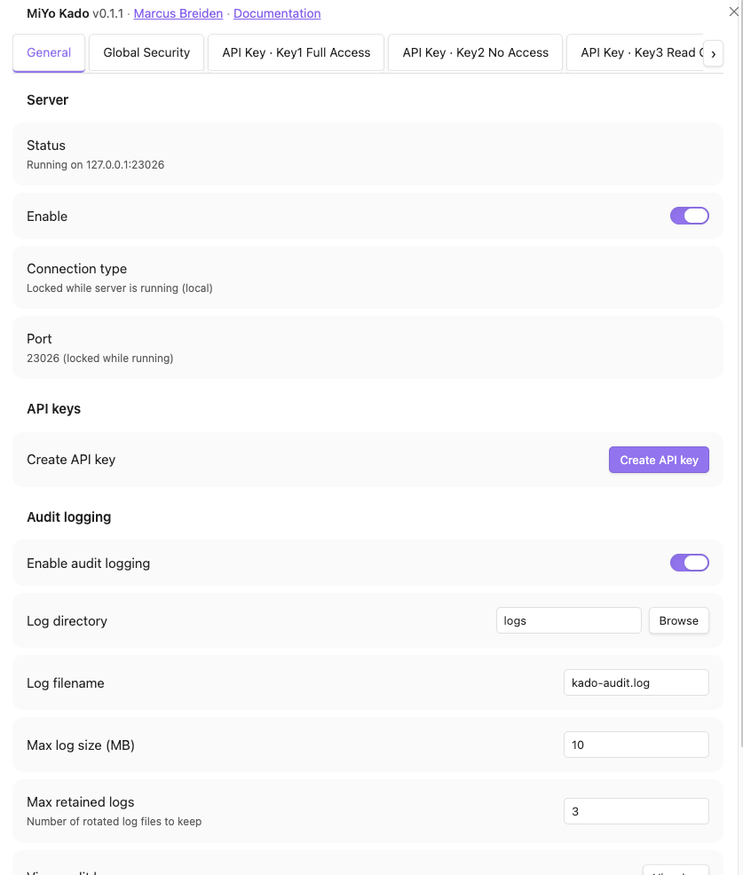
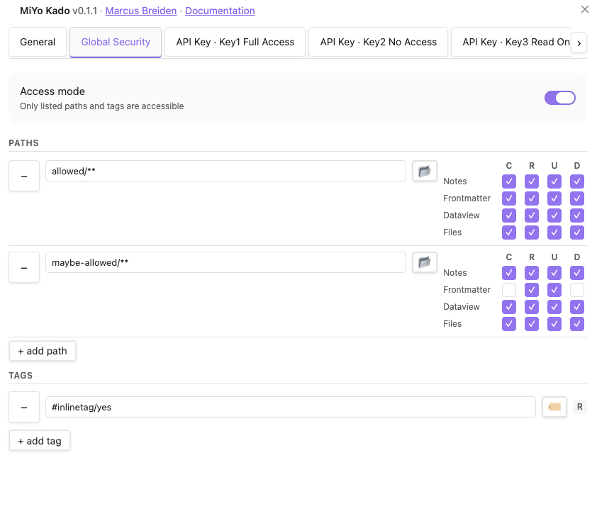
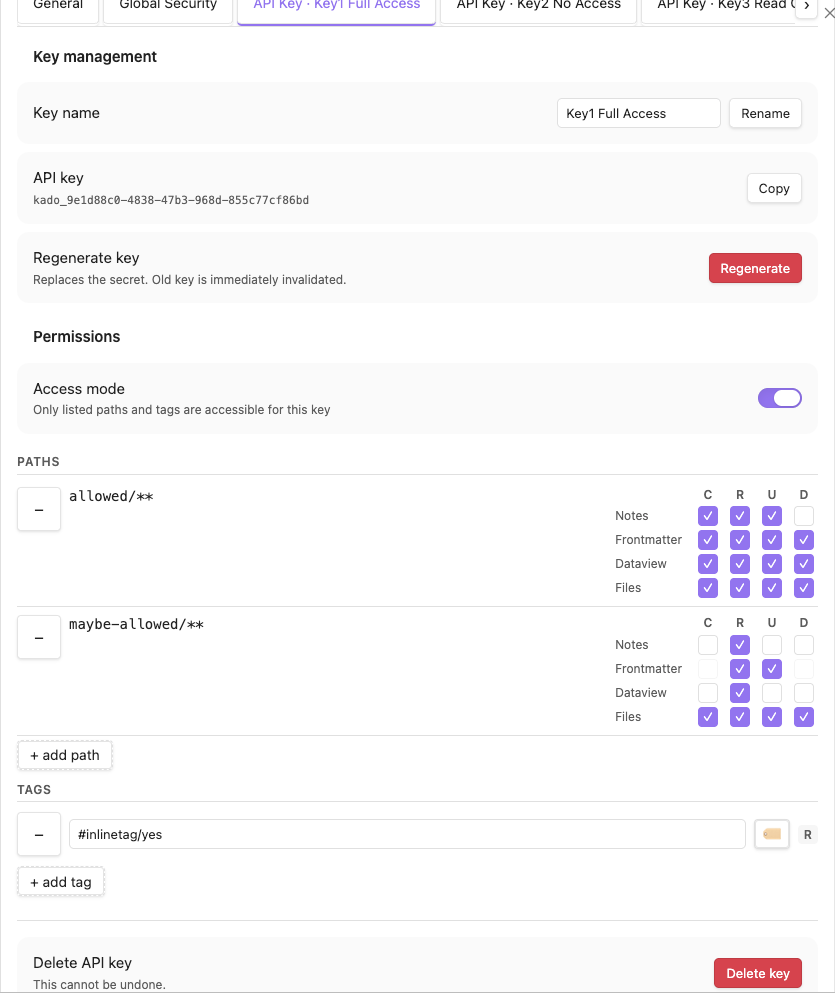
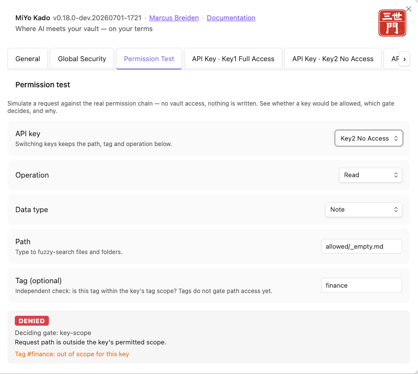
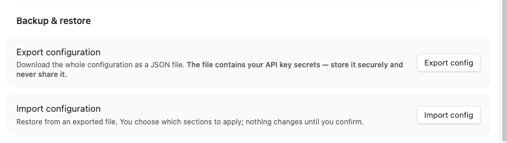
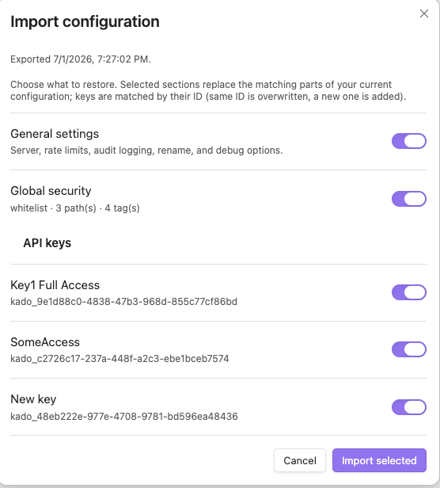

# Configuration Guide

Settings are in **Settings > MiYo Kado** with these tabs: General, Global Security, Permission Test, and one tab per API key.

For installation, see [Installation](installation.md). For connecting your AI client, see [Client Setup](client-setup.md).

## General Tab

  

| Setting | Default | Description |
|---------|---------|-------------|
| Server enabled | Off | Start/stop the MCP server |
| Host | `127.0.0.1` | Bind address |
| Port | `23026` | TCP port |
| Connection type | `local` | `local` (127.0.0.1) or `public` (0.0.0.0) |
| Rate limit (requests per window) | `20` | Max requests per IP per window. `0` disables throttling. Applies live. |
| Rate limit window (seconds) | `5` | Length of the rate-limit window. Applies live. |
| Audit logging | On | Enable NDJSON audit log ([format details](how-it-works.md#audit-log)) |
| Log directory | `logs` | Vault-relative path for log files |
| Max log size | 10 MB | Triggers rotation |
| Retained logs | 3 | Number of rotated files to keep |

## Global Security Tab

  

The global security scope defines what is **eligible** for access across all API keys. No key can exceed these boundaries.

### Access Mode

- **Whitelist** (default): only listed paths are accessible. Nothing else exists to API keys.
- **Blacklist**: everything is accessible except listed paths.

For details on how the mode flip works, see [How It Works -- Whitelist / Blacklist Mode Flip](how-it-works.md#whitelist--blacklist-mode-flip).

### Paths

Add vault folders to the security scope. Each path entry has independent CRUD permissions per data type:

| Data Type | What it controls |
|-----------|-----------------|
| Notes | Reading/writing full markdown content |
| Frontmatter | Reading/writing YAML metadata |
| Dataview | Reading/writing inline fields like `[status:: active]` |
| Files | Reading/writing binary files (images, PDFs, etc.) |

Each data type has four permission flags: **C**reate, **R**ead, **U**pdate, **D**elete.

### Permission semantics per data type

Not every flag does something for every data type. The table below shows what each flag
actually performs — `n/a` marks a flag that has no effect (see footnotes):

| Data type | C (create) | R (read) | U (update) | D (delete) |
|-----------|-----------|----------|-----------|-----------|
| Notes | Create a new `.md` file | Read the full body (and `tags`) | Overwrite the whole body | Move the note to trash |
| Files | Create a new binary file | Read content as base64 | Overwrite the bytes | Move the file to trash |
| Frontmatter | `n/a` (1) | Read the YAML object | Merge keys (default) or replace the block | Remove specific keys |
| Dataview | `n/a` (1) | Read inline fields | Replace values of **existing** fields (3) | `n/a` (2) |
| Tags | `n/a` (4) | Read tags (4) | `n/a` (4) | `n/a` (4) |

1. There is no standalone "create" for frontmatter or Dataview values. Both adapters require an
   existing `.md` file, and any change to an existing file is classified as an **update** — so
   adding frontmatter keys or Dataview values needs **U**, not C (frontmatter uses `merge` mode to
   add new keys). The `create` flag for these two types is therefore inert.
2. Deleting individual Dataview inline fields is intentionally not supported — regex-based line
   removal is too risky for a destructive operation. Clear a value with U, or delete the whole note.
3. Update only changes inline fields that **already exist**; Kado cannot insert a brand-new inline
   field.
4. `tags` is a **read-only derivative** of the note body and frontmatter — it has no CRUD flag of
   its own. A tags read is granted by `note` **R** (returns inline *and* frontmatter tags,
   `returnedTags="All"`) **or** `frontmatter` **R** (frontmatter tags only,
   `returnedTags="FrontmatterOnly"`). There is no create/update/delete for tags. This is separate
   from the search-tag list (see [Search tags](#search-tags) below), which only filters *which* tags are
   visible in search results and is not a CRUD permission, and from [tag rules](#tag-rules), which
   decide which notes are accessible by their tags.

Create versus update is decided by the presence of `expectedModified` on the write — see
[API Reference -- Create vs Update Flow](api-reference.md#create-vs-update-flow).

### Path Patterns

Paths in the security scope use glob-style patterns:

| Pattern | Matches | Example |
|---------|---------|---------|
| `**` | **Full vault** -- every file and folder | Grant an API key access to the entire vault |
| `Calendar` | The `Calendar` folder itself **and** everything inside it | Equivalent to `Calendar` + `Calendar/**` |
| `Calendar/**` | Only the **contents** of `Calendar/` (not the folder node itself) | Scope the files, leave the folder node under a broader rule |
| `Atlas/202*` | Folders/files in `Atlas/` starting with `202` | `Atlas/202 Notes`, `Atlas/2024 Archive` |
| `Atlas/Project.md` | A **single note/file** | Give one note a different permission than its siblings |

The folder picker includes a `** (Full vault)` entry at the top for convenience. You can also type patterns manually in the text input — including a **single file path** (a note-level scope) or a `folder/**` pattern.

**Tip**: When you add a path using the folder picker, just select the folder name (e.g. "Calendar"). The plugin automatically matches all files inside that folder and its subfolders.

**Note — bare folder vs `folder/**`.** A bare `Calendar` matches both the folder node *and* its contents (it auto-expands to also cover `Calendar/**`). `Calendar/**` matches only the *contents*, not the folder node. This distinction matters when you want a rule to apply to a folder's files but leave the folder node itself governed by a broader rule (e.g. so the folder can still be renamed under that broader rule). The **folder browse picker returns the bare form** — add `/**` by hand when you need the contents-only variant.

### Tag rules

Tag rules restrict **which notes** are accessible by the tags they carry — on top of the path rules. They are a filter: they can only ever *remove* access that the path rules grant, never add it. CRUD permissions stay on the path entries.

- **Only notes tagged** (`tagAllow`) -- when set, a note must carry **at least one** of these tags. Untagged notes and notes with only other tags are blocked. An empty list means no restriction.
- **Never notes tagged** (`tagDeny`) -- a note carrying **any** of these tags is blocked.
- **Deny always wins.** A note tagged `#Work` and `#Private` is blocked when `#Private` is denied, even if `#Work` is allowed.
- **Nested tags match.** `Work` also matches `#Work/ProjectA`; `Work/*` matches only sub-tags.
- Frontmatter `tags` and inline `#tags` both count (tags inside code blocks do not).
- **Global and key rules are evaluated independently** -- a note must pass both.
- **Notes only.** Tag rules apply to notes, frontmatter, Dataview inline fields and the tags read. Attachments (`file` data type) have no tags and stay governed by path rules alone -- for a tag-scoped key, set `file.read = false` or scope files by path.

How operations are checked:

| Operation | Checked against |
|---|---|
| read, update, delete, rename (existing note) | the note's **current** tags, read from the file content |
| create a note | the tags in the **new content** -- with *Only notes tagged* set, the content must carry an allowed tag |
| folder rename | **every** note in the folder must pass |
| search, list, graph, graph audit, open notes | notes that fail are left out of the results (and out of `listTags` counts and `listDir` child counts) |

Denials come back as `FORBIDDEN` and are recorded with the gate name `tag-access` in the audit log and the Permission Test.

**Example -- an employer key in a flat, tag-organised vault:** give the key the path `**` with the permissions you want, set **Only notes tagged** to `Work`, and disable `file.read`. The key then sees and edits only notes tagged `#Work` (including `#Work/...`); new notes it creates must carry `#Work`. Add `Private` to **Never notes tagged** to carve out exceptions.

Search results use Obsidian's metadata index. Right after a restart or a bulk external change, a note that is not indexed yet is treated as untagged-and-unknown and left out of results until it is indexed (it is never shown by mistake).

### Search tags

Search tags restrict which tags search operations may filter by (`listTags`, `byTag`). When tags are configured, only matching tags appear in results. They do **not** restrict which notes are accessible -- use tag rules for that.

Tags listed in **Only notes tagged** (global or key) are added to the search tags automatically, so a key limited to `#Work` can search by `Work` without entering it twice.

- Use `*` to grant access to **all tags** in the vault.
- Tag patterns support wildcards: `project/*` matches `project/alpha`, `project/beta`, etc.
- If no search tags and no *Only notes tagged* rules are configured, tag-based search operations return no results.

## API Key Management

  

Each API key is an independent access credential with its own scope.

### Creating a Key

1. Open **Settings > MiYo Kado**
2. Click **Create API Key** in the General tab
3. Set a descriptive label
4. Configure paths and permissions (subset of global security)
5. Copy the key ID -- this is the Bearer token for MCP clients

### Key Permissions

Each key has:

- **Access mode** -- independent whitelist/blacklist, intersected with global scope
- **Paths** -- each with their own CRUD permissions per data type. **+ add path** opens a folder browser (Obsidian's native fuzzy picker) limited to folders *within* the global scope: pick a whole global path or any subfolder of one to narrow the key for least-privilege access (e.g. global `Atlas` → key `Atlas/202 Notes`). Just pick the folder -- no need to type `/**`; a folder name already covers everything inside it. A narrowed path's permissions are still capped by its parent global path, so unavailable CRUD cells appear greyed out. When a key has both a broad path and a narrower one inside it, the **most specific entry wins** for the paths it covers -- so a key can have broad access with a tighter island (e.g. `allowed` full CRUD but `allowed/sub` read-only).
- **Tag rules** -- *Only notes tagged* / *Never notes tagged* for this key, evaluated in addition to the global tag rules (see [Tag rules](#tag-rules))
- **Search tags** -- subset of global search tags, controls which tags the key can search by

For details on how global and key scopes intersect, see [How It Works -- Scope Intersection](how-it-works.md#scope-intersection).

### Regenerating a Key

Click **Regenerate** to replace the secret. The old key is immediately invalidated. Connected clients will need the new value.

### Deleting a Key

Click **Delete API key** in the danger zone. This cannot be undone.

## Permission Test Tab

  

Configuring whitelists, blacklists, and per-datatype CRUD flags across a global scope and each key's scope is easy to get subtly wrong. The **Permission Test** tab lets you check the outcome before an assistant ever connects — it runs the *same* permission chain the live tools use, purely in memory. Nothing is read from or written to the vault.

Pick:

- **API key** -- which key to simulate. Switching keys keeps the fields below, so you can compare two keys against the same path.
- **Operation** -- `read`, `create`, `update`, `delete`, `rename / move`, or `search`. (Write is split into create/update because they are gated independently.)
- **Data type** -- note, frontmatter, file, Dataview inline field, or tags (the choices narrow to what each operation supports; hidden for search).
- **Path** -- start typing to fuzzy-search files and folders. For a rename you also enter a **Target path**; same folder is treated as a rename (needs `update`), a different folder as a move (needs `delete` on the source **and** `create` on the target).
- **Note tags** *(optional)* -- the tags the note carries, for tag rules. Leave empty to use the note's current tags (a path that does not exist yet counts as untagged); enter them, comma-separated, to test a create.
- **Search tag** *(optional)* -- start typing to fuzzy-search vault tags.

The result shows **ALLOWED** or **DENIED**; on a denial it names the **deciding gate** (authenticate, global-scope, key-scope, datatype-permission, path-access, or tag-access) and the reason. When tag rules are configured it also shows which note tags were used. This is exactly what the assistant would have seen.

The search-tag field is an independent readout: it reports whether the tag is within the key's effective search-tag scope (global ∩ key) for `kado-search byTag`. It never changes the verdict -- note access by tag is decided by the tag rules and the note tags above.

## Backup & Restore

  

The **General** tab has a Backup & restore section for moving your whole configuration between vaults or machines and recovering from mistakes.

### Export

**Export config** downloads the entire configuration — server settings, global security scope, every API key, and audit settings — as a single `kado-config.json` file.

> ⚠️ **The export contains your API key secrets** (the `kado_…` values are the bearer tokens clients authenticate with). Treat the file like a password: store it securely, and never commit it or share it. This is deliberate — a backup has to include the secrets so a restore reconnects your existing clients without reconfiguring them.

### Import

**Import config** opens a file picker, validates the file, then shows a chooser so you restore exactly what you want:

  

- **General settings** — server, rate limits, audit logging, rename, debug options.
- **Global security** — the whole global scope (mode, paths, tags).
- **Each API key** — pick any subset. A key is matched by its id: an imported key with an existing id **overwrites** it, a new id is **added**. Unselected keys are left untouched.

Nothing changes until you confirm. Selected sections replace the matching parts of your current config; the rest is left as-is. If the server is running and you import general settings, it restarts automatically so the new settings take effect.

This makes common tasks easy: copy one vault's global security to another, hand a single key to a second machine, or roll back after a bad change — without a full replace.

## What's next

- [Example Configurations](example-configs.md) -- common setups with permission matrices
- [How It Works](how-it-works.md) -- architecture, enforcement logic, audit log
- [Client Setup](client-setup.md) -- connect Claude, Cursor, Windsurf
- [API Reference](api-reference.md) -- tool schemas, parameters, error codes
